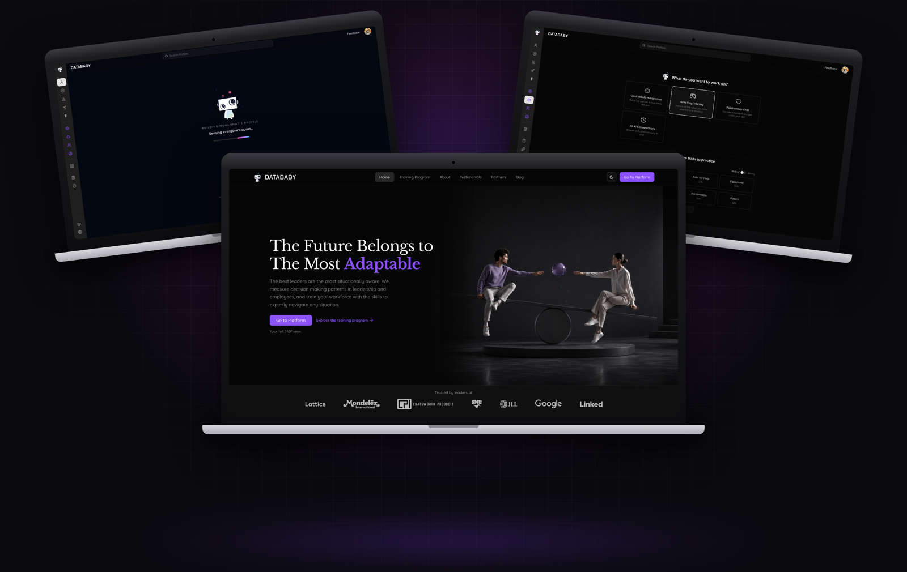
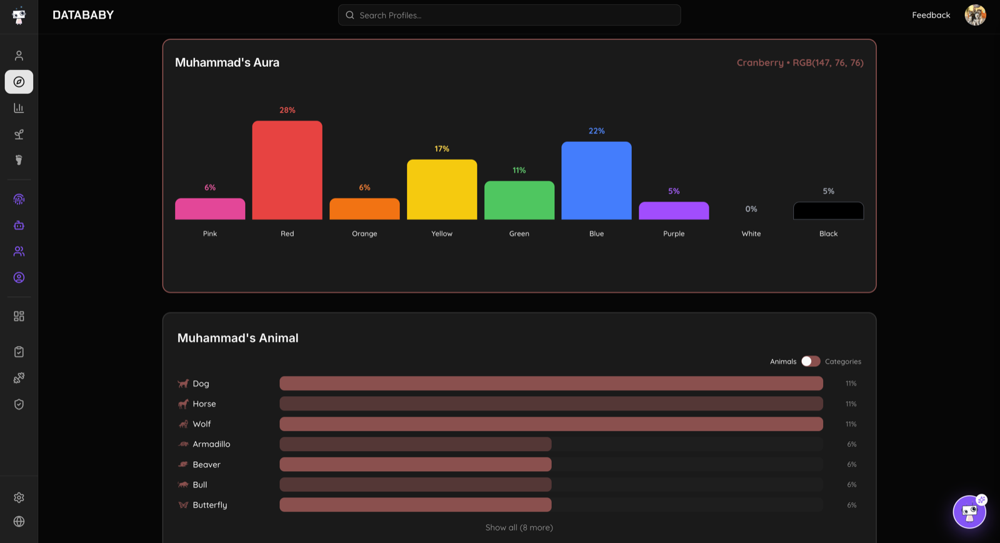
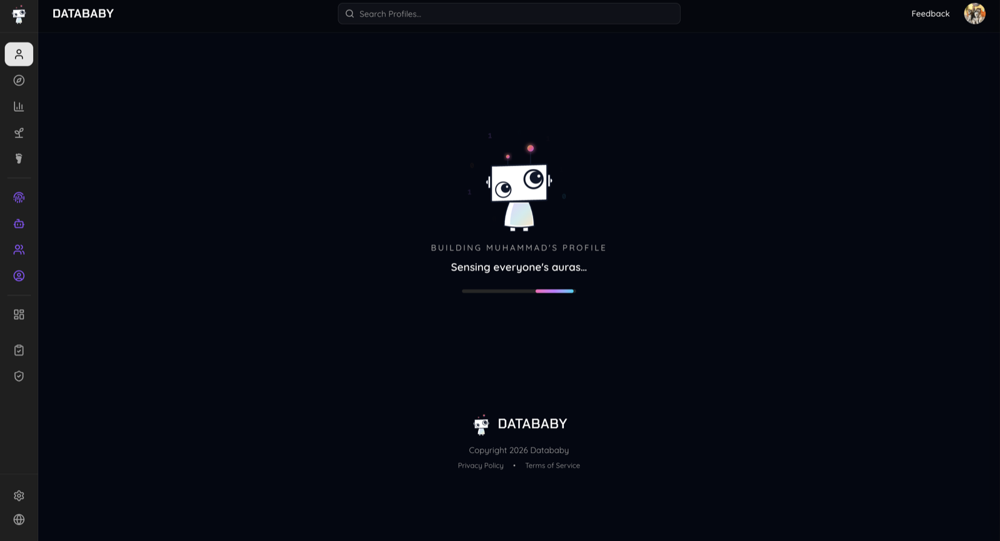
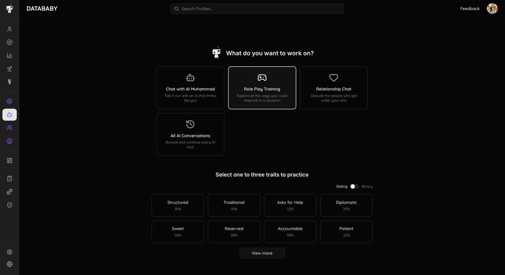
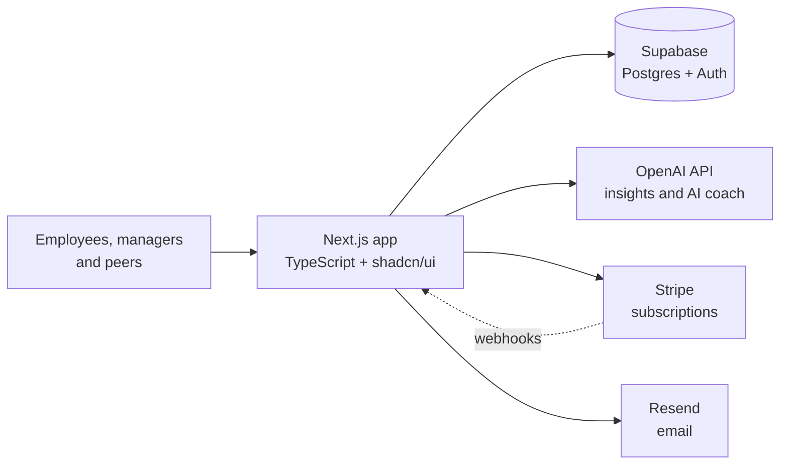

# Datababy

**360-degree behavioral assessment platform for leadership and professional development, built for enterprise HR and L&D teams.**

> This is a showcase repo. Datababy is a client product and its source code is private, so this page covers what it does, how it's built and what it looks like. Happy to walk through the work on a call.

## The problem

Traditional personality frameworks like DISC or Myers-Briggs box people into fixed types. Leadership and L&D teams get a static label instead of a real picture of how someone behaves under pressure, on a team or across contexts, and no clear way to act on it.

## What I built

I built Datababy end to end for the client, from the data model to the UI, payments and AI features.

- **Flexible behavioral polarities** (e.g. Experimental vs Traditional, Candid vs Diplomatic) instead of fixed types
- **360-degree assessments** gathered from peers, managers and teams through shareable survey links
- **Personal reports** mapping each person's pattern across self, leadership, team and cross-functional contexts
- **Rigidity flags** that highlight patterns likely to cause friction or burnout, plus complementary team pairings
- **AI coach**: chat with an AI version of yourself, role-play training scenarios and relationship chats, grounded in the person's own results
- **Subscriptions and payments** with Stripe, transactional email with Resend
- **An Assess, Train, Re-measure cycle** delivered through team cohorts, 1:1 coaching and AI simulation training

## Screenshots

| Report | Profile |
| --- | --- |
|  |  |

| Aura breakdown | AI coach |
| --- | --- |
|  |  |

## Architecture

## Tech stack

React Hook Form for the multi-step assessment flows.

## Contact

**Muhammad Izhar** · [izhar.dev](https://izhar.dev) · [LinkedIn](https://linkedin.com/in/izharrr99) · muhammad.izhar11@gmail.com
